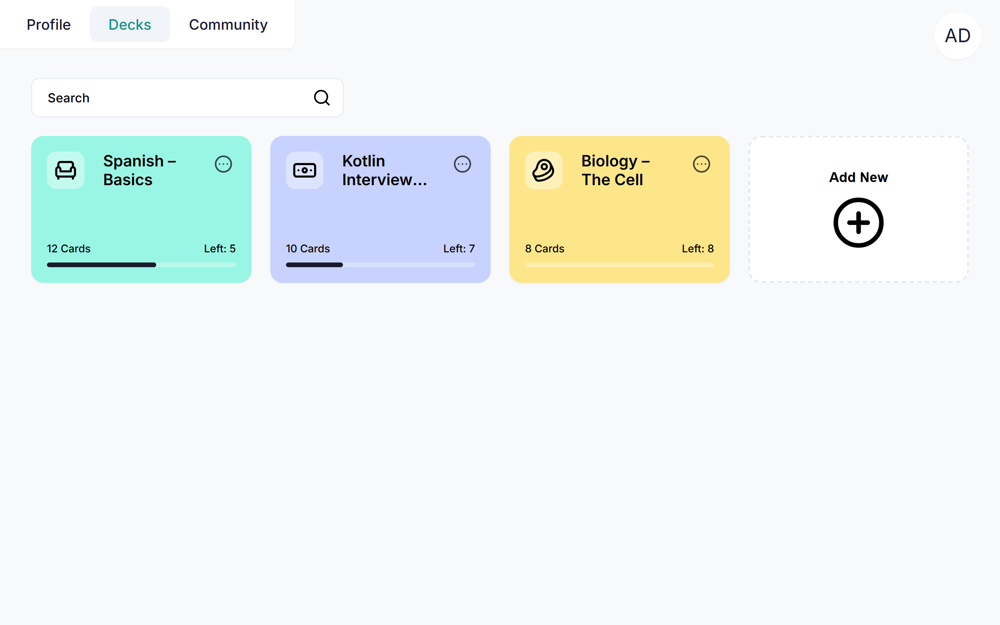
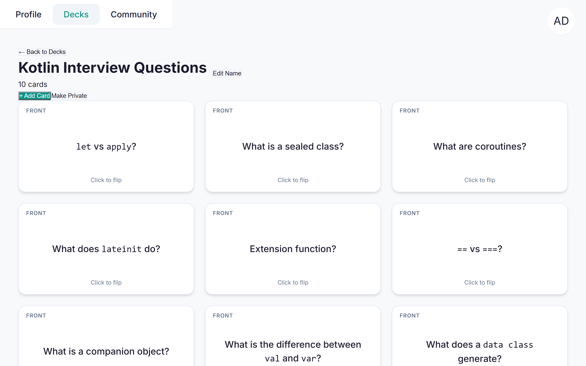
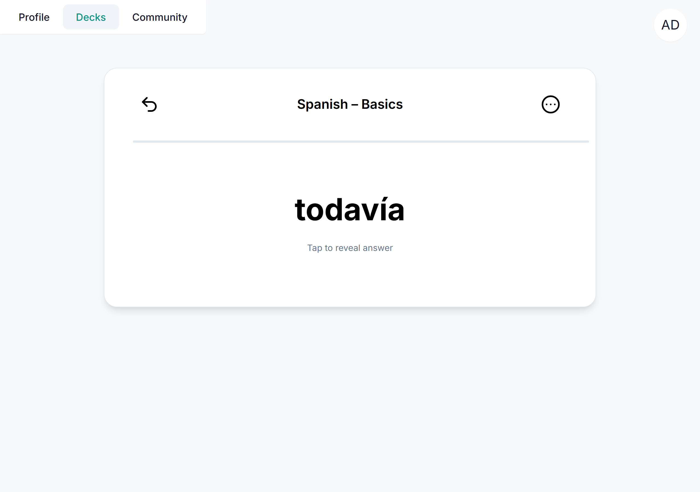
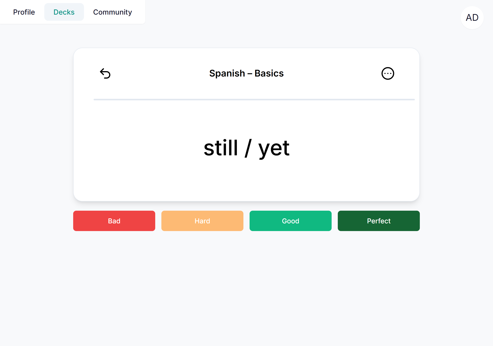
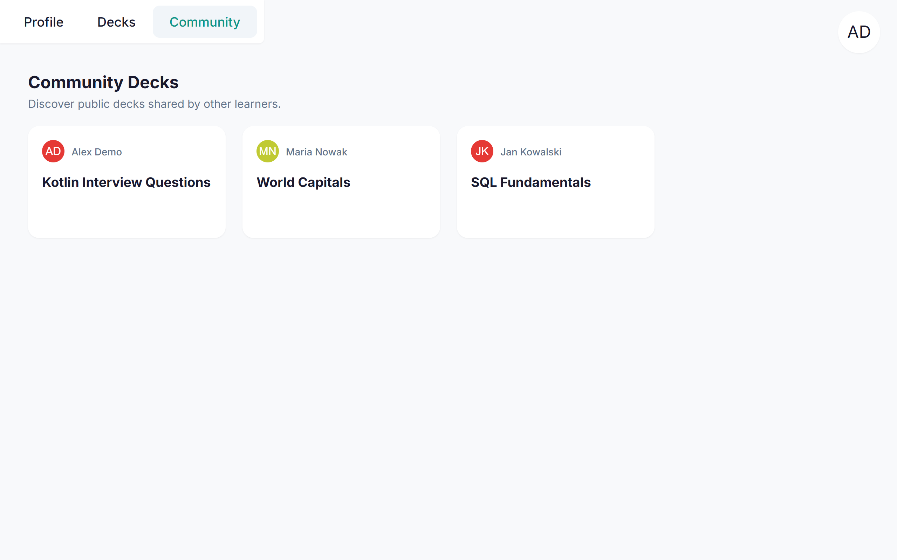
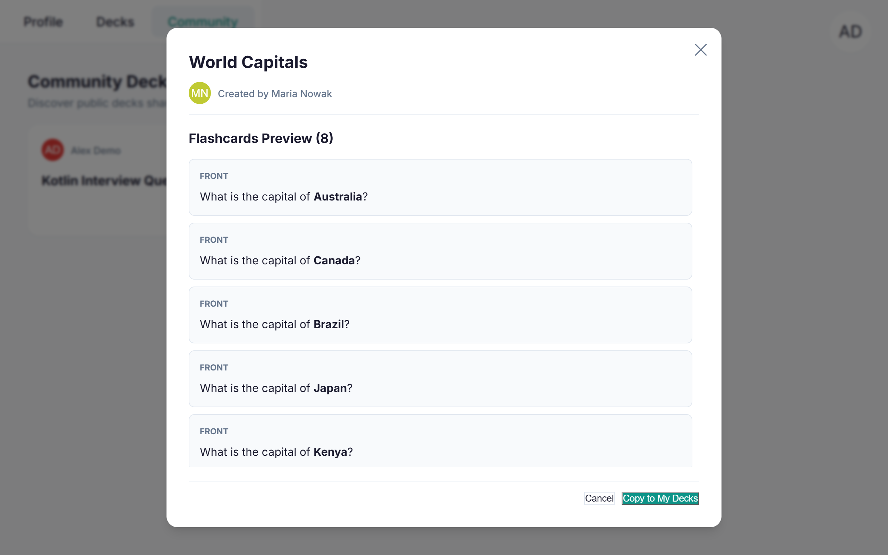
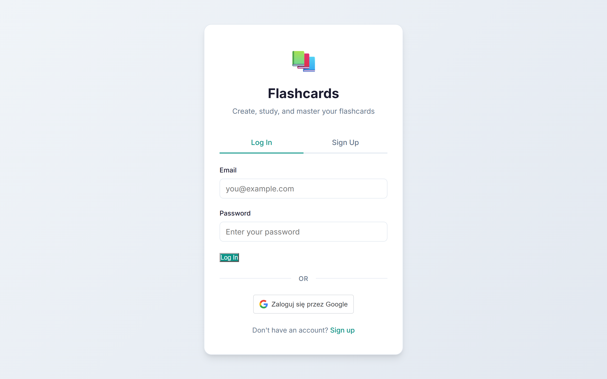

# Flashcards

A full-stack spaced-repetition flashcard app. It schedules your reviews with the **FSRS algorithm** (the same one modern Anki uses), so you study each card right before you'd forget it.


## Features

- **Smart scheduling with FSRS:** each review updates the card's stability and difficulty, and the next review date is calculated from them
- **Four-button rating:** Bad / Hard / Good / Perfect, like Anki
- **Rich-text cards:** formatting, lists, code and images with a TipTap editor
- **Community decks:** publish your deck, browse other people's decks, preview them and clone them into your account
- **Secure accounts:** email + password (BCrypt) or Google sign-in, stateless JWT authentication, users can only access their own data
- **Study sessions:** only cards that are due are shown, ordered by due date

## Screenshots

<table>
  <tr>
    <td width="50%"></td>
    <td width="50%"></td>
  </tr>
  <tr>
    <td align="center">Your decks with study progress</td>
    <td align="center">Cards in a deck</td>
  </tr>
  <tr>
    <td width="50%"></td>
    <td width="50%"></td>
  </tr>
  <tr>
    <td align="center">Study mode: question</td>
    <td align="center">Study mode: answer and rating</td>
  </tr>
  <tr>
    <td width="50%"></td>
    <td width="50%"></td>
  </tr>
  <tr>
    <td align="center">Community decks</td>
    <td align="center">Preview and copy a public deck</td>
  </tr>
  <tr>
    <td width="50%"></td>
    <td width="50%"></td>
  </tr>
  <tr>
    <td align="center">Log in with email or Google</td>
    <td></td>
  </tr>
</table>

## Tech stack

| Layer | Technologies |
|---|---|
| Backend | Kotlin 2.3, Spring Boot 4.1, Spring Web MVC, Spring Data JPA, Spring Security |
| Auth | JWT, BCrypt, Google OAuth 2.0 (Google ID token verification) |
| Scheduling | [FSRS](https://github.com/open-spaced-repetition) (open-spaced-repetition Java library) |
| Database | PostgreSQL 15 (Docker Compose) |
| Frontend | React 19, Vite 6, TipTap 3 |
| Testing / CI | JUnit 5, Mockito, GitHub Actions |


## How spaced repetition works here

Every card stores its FSRS memory state:

| Field | Meaning |
|---|---|
| `state` | New, Learning, Review or Relearning |
| `due` | When the card should be shown next |
| `stability` | How long the memory lasts (higher = longer intervals) |
| `difficulty` | How hard the card is for you |
| `step`, `lastReview` | Learning step and time of the last review |

When you rate a card (1 = Bad, 2 = Hard, 3 = Good, 4 = Perfect), the backend runs the FSRS scheduler and saves the new values. A study session loads only cards with `due <= now`, ordered by due date.

## Key engineering decisions

- **Stateless JWT auth** instead of server sessions, so the API is easy to scale and the frontend can be hosted separately.
- **Ownership checks on every endpoint:** the user ID always comes from the token, and accessing someone else's data returns 404 (not 403), so IDs can't be probed.
- **DTOs instead of entities** in responses, so sensitive fields like password hashes never leave the server.
- **Images stored in PostgreSQL** (`bytea`): simple to deploy with no extra storage service. The trade-off is database size.
- **FSRS via a maintained library** instead of a hand-written formula, with the card state persisted so the algorithm can continue exactly where it left off.

## Getting started

### Prerequisites
- JDK 23
- Node.js 20+
- Docker Desktop

### 1. Clone
```bash
git clone https://github.com/mat-duda/Flashcards-Web.git
```
```bash
cd Flashcards-Web
```

### 2. Configure
Copy the example files and fill in your values:
```bash
cp .env.example .env
```
```bash
cp application.properties.example application.properties
```
```bash
cp frontend/.env.example frontend/.env
```
Google sign-in needs an OAuth client ID from the [Google Cloud Console](https://console.cloud.google.com/apis/credentials) (authorized origin `http://localhost:5173`). Email/password login works without it.

### 3. Start the database
```bash
docker compose up -d
```

### 4. Run the backend (http://localhost:8080)
```bash
./gradlew bootRun
```

### 5. Run the frontend (http://localhost:5173)
```bash
cd frontend
```
```bash
npm install
```
```bash
npm run dev
```

## API overview

All endpoints except `/api/auth/**` require `Authorization: Bearer <token>`.

| Method | Endpoint | Description |
|---|---|---|
| POST | `/api/auth/register` | Create an account, returns a JWT |
| POST | `/api/auth/login` | Log in with email + password |
| POST | `/api/auth/google` | Log in with a Google ID token |
| GET | `/api/decks` | My decks |
| POST | `/api/decks` | Create a deck |
| PUT / DELETE | `/api/decks/{id}` | Edit / delete my deck |
| GET | `/api/decks/public` | Community decks |
| POST | `/api/decks/{id}/clone` | Clone a public deck |
| GET | `/api/flashcards/deck/{deckId}` | Cards in a deck |
| GET | `/api/flashcards/deck/{deckId}/study` | Cards due for review |
| POST | `/api/flashcards` | Create a card |
| PUT / DELETE | `/api/flashcards/{id}` | Edit / delete my card |
| POST | `/api/flashcards/{id}/review` | Submit a rating (1–4) |
| POST | `/api/uploads` | Upload an image (max 5 MB) |

## Tests

```bash
./gradlew test
```

- **Unit tests** for the FSRS scheduling logic

## Project structure

```
Flashcards-Web/
├── src/main/kotlin/org/example/flashcardsweb/
│   ├── controller/   REST endpoints
│   ├── service/      business logic (decks, flashcards, FSRS, access checks)
│   ├── security/     JWT filter, token service, Google token verification
│   ├── model/        JPA entities
│   ├── repository/   Spring Data repositories
│   ├── dto/          request/response objects
│   └── config/       CORS, password encoder, error handling
├── frontend/src/
│   ├── api/          API clients
│   └── components/   React components
└── docker-compose.yml
```

## Roadmap

- [ ] Statistics page (reviews per day, retention)
- [ ] Import decks from Anki (.apkg) and CSV
- [ ] Mobile-friendly layout


## Author

**Mateusz Duda** · [GitHub](https://github.com/mat-duda) · [LinkedIn](https://www.linkedin.com/in/mat-duda/)
## License

Copyright © 2026 Mateusz Duda. All rights reserved.

This repository is public for portfolio purposes only. You may view the code, but you may not copy, modify, distribute or use it, in whole or in part, without my written permission.